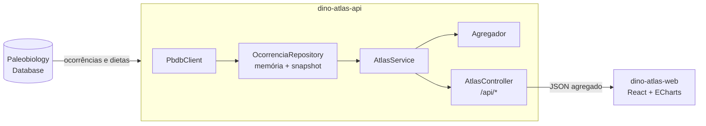

<div align="center">

# Dino Atlas

Painel interativo em estilo 8-bit com todas as ocorrências fósseis de dinossauros registradas no Paleobiology Database, do Triássico às aves do Quaternário.


**[Ver demo](https://victoriacaroline.github.io/dino-atlas/)**

<sub>A demo roda só o front, com uma amostra embutida. O projeto completo, com os 37 mil registros do PBDB, roda localmente com o back-end.</sub>

</div>

## Sobre

O Dino Atlas baixa os registros fósseis de Dinosauria do [Paleobiology Database (PBDB)](https://paleobiodb.org), classifica cada ocorrência por período, grupo e dieta, e mostra tudo num painel com cara de RPG antigo: barras de HP, árvore de habilidades e um Quest Log com a ficha de cada gênero.

## Funcionalidades

- **World Map:** cada ponto é um fóssil, colorido pelo período. Clicar abre a ficha do gênero.
- **Filtros:** seis períodos geológicos e três tipos de dieta, aplicados a todos os painéis ao mesmo tempo.
- **Party:** composição por grupo (terópodes, aves, sauropodomorfos, ornitísquios e outros) em barras de HP.
- **Skill Tree:** cladograma dos grupos principais, com a contagem de registros.
- **High Score:** países com mais ocorrências.
- **Timeline:** número de gêneros distintos por faixa de 10 milhões de anos.
- **Quest Log:** ficha do gênero selecionado, com link para o verbete na Wikipédia.
- **Modo demo:** roda só o front, com uma amostra embutida, sem precisar do back-end.

## Stack

| Camada | Tecnologia |
|---|---|
| Back-end | Java 21, Spring Boot 3.3, RestClient, cache em memória com snapshot em disco |
| Front-end | React 18, TypeScript, Vite, ECharts (importado por módulo), CSS próprio em estilo 8-bit |
| Dados | Paleobiology Database API |

## Arquitetura



O back-end consulta o PBDB uma vez, guarda tudo em memória e grava um snapshot em `data/pbdb-cache.json`. As próximas subidas leem o snapshot, que é renovado toda semana. O front nunca fala com o PBDB direto: recebe só os números prontos de cada painel.

## Como rodar

**Pré-requisitos:** Java 21, Maven, Node 18+.

Back-end:

```bash
cd dino-atlas-api
mvn spring-boot:run
```

A primeira subida baixa todos os registros do PBDB e pode levar vários minutos. A API sobe em `http://localhost:8080`.

Front-end:

```bash
cd dino-atlas-web
npm install
cp .env.example .env
npm run dev
```

Abra `http://localhost:5173`.

**Só o front, sem back-end:** defina `VITE_MOCK=true` no `.env`.

## Endpoints

| Endpoint | Retorno |
|---|---|
| `GET /api/resumo` | Totais de ocorrências, gêneros, países e faixa de idade |
| `GET /api/dieta` | Distribuição por dieta |
| `GET /api/grupos` | Distribuição por grupo |
| `GET /api/paises?top=8` | Países com mais ocorrências |
| `GET /api/diversidade?faixa=10` | Gêneros distintos por faixa de tempo |
| `GET /api/ocorrencias` | Pontos do mapa |
| `GET /api/generos/{nome}` | Ficha de um gênero |

Todos aceitam os filtros `periodo`, `dieta` e `grupo`. Detalhes no [README da API](dino-atlas-api/README.md).

## Decisões de projeto

- **Grupos sem dupla contagem:** cada grupo é uma consulta separada ao PBDB, com exclusões. `Theropoda^Aves` tira as aves dos terópodes, e "Outros" pega o que sobra de Dinosauria.
- **Período pela idade média:** o PBDB informa um intervalo de idade para cada fóssil. O período é definido pela média desse intervalo, então um fóssil que cruza uma fronteira vai para o lado onde está a média.
- **Material indeterminado:** fósseis identificados só até família ou acima (ex.: "Hadrosauridae indet.") entram nas contagens e no mapa, mas não na contagem de gêneros nem na curva de diversidade.
- **Dieta simplificada:** o vocabulário do PBDB (piscivore, browser, grazer...) é reduzido a carnívoro, herbívoro, onívoro ou desconhecida.
- **Regras sem framework:** os cálculos ficam no pacote `domain`, sem dependência do Spring, e são testados isoladamente.

## Fonte dos dados

Dados do [Paleobiology Database](https://paleobiodb.org), distribuídos sob licença CC BY 4.0. Resumos dos gêneros via [Wikipédia](https://pt.wikipedia.org).

---

<div align="center">


⭐ If you like this project, don't forget to Star the Repository!


</div>
